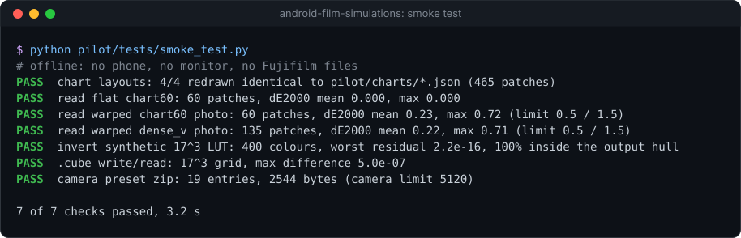

# Android Film Simulations

**A hobby project I built to learn ADB: driving an Android phone's camera over adb to try Fujifilm film looks.**

[](https://github.com/Sohwhat6420/android-film-simulations/actions/workflows/test.yml)
[](LICENSE)


> [!NOTE]
> **This is rough.** It ran end to end once, on one phone (a POCO X6 Pro, 18 to 19 October 2026). The scripts in
> [`pilot/`](pilot) are exactly as they ran, not a finished tool. It is not an app, and nothing here installs a film
> look on your phone for you. Expect to read the scripts and adjust them for your own phone.

## What it does

I wanted to know how close a phone's own camera could get to Fujifilm's film looks, and it was a good excuse to learn
adb. The scripts:

- **Drive the camera over adb.** [`phone.py`](pilot/scripts/phone.py) taps the shutter button (its position read
  from the camera's layout with a `uiautomator` dump), waits for the photo to finish writing and pulls it back. A
  sweep shot about 490 photos this way, unattended.
- **Read colour charts from the photos.** The phone photographs charts on a monitor; ArUco markers in the corners
  let the scripts find and read every colour patch.
- **Compare against Fujifilm's own looks.** Each camera setting is scored against Fujifilm's free film simulation
  LUTs, on colours the fit never saw.

## Quick start

Python 3.11 or later. The smoke test needs no phone, monitor or Fujifilm files:

```bash
git clone https://github.com/Sohwhat6420/android-film-simulations && cd android-film-simulations
pip install -r pilot/requirements.txt
python -X utf8 pilot/tests/smoke_test.py
```



## What came out of it

On that one phone, the camera's own filters and sliders got close for a few looks and not for others. The black and
white look (Acros) came close with one setting; two looks (Classic Neg. and Bleach Bypass) were out of reach of the
phone's controls altogether; and for several looks the best advice was to leave the camera alone. The per-look
numbers are in [pilot/results/poco-x6-pro.json](pilot/results/poco-x6-pro.json), and [pilot/METHOD.md](pilot/METHOD.md)
has the procedure.

What it did not do: it never tested the looks on a second phone, and the most accurate route it found (importing a
`.cube` file into the Gallery editor) was only simulated on a laptop, never tried on the phone.

## Fujifilm's data stays on your machine

Fujifilm publishes its film simulation LUTs for free, but its terms do not allow redistribution. So this repository
holds only the scripts: you download Fujifilm's LUT pack yourself into `pilot/sources/` (never committed), and
everything Fujifilm-derived is built on your own machine.

## Running it on a phone

You need a phone with Wireless debugging on, a monitor for the charts, and Fujifilm's free F-Log2 LUT pack in
`pilot/sources/`. Set `ADB_SERIAL` to your phone's serial from `adb devices`. `pilot/scripts/run_pilot_chain.sh` is
the order the pilot ran in, and each sweep resumes from its own log. The shutter position and camera modes are the
POCO's; another phone will need its own. [docs/ARCHITECTURE.md](docs/ARCHITECTURE.md) explains how the pieces fit.

## Licence

MIT, for the code in this repository. Fujifilm's LUTs remain under Fujifilm's own terms. By Ethan Soh
([Sohwhat6420](https://github.com/Sohwhat6420)).
