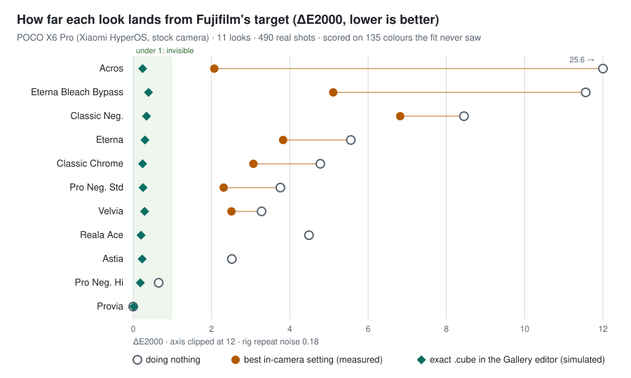

# Android Film Simulations

[](https://github.com/Sohwhat6420/android-film-simulations/actions/workflows/test.yml)


Fujifilm film simulation colours on a stock Android camera, **measured**, not eyeballed.

**Why it's interesting:** film-look presets online are judged by eye. This pipeline drives the phone over adb,
photographs colour charts on a monitor (about 490 automated shots), reads every patch through ArUco markers and
scores each look in ΔE2000 against Fujifilm's own LUTs, on colours the fit never saw. It tells you the best setting
the phone's own camera can reach, and when the honest answer is "leave the camera alone".



```bash
pip install -r pilot/requirements.txt
python pilot/tests/smoke_test.py      # offline: no phone, monitor or Fujifilm files needed
python pilot/scripts/charts.py --page dense_v   # draws a held-out test chart into pilot/charts/
```

<details><summary>Smoke test output (7 checks, about 4 s)</summary>


</details>

> **Status:** the method has run end to end on one phone, a POCO X6 Pro (Xiaomi HyperOS, 18–19 Oct 2026). The
> pilot's scripts are in [`pilot/`](pilot) exactly as they ran. Xiaomi 14T, Samsung Galaxy S24 Ultra and Huawei
> P30 Pro come next. The exact `.cube` tier is a laptop simulation until it is tested on the phone.

## Results so far (POCO X6 Pro pilot)

ΔE2000 against Fujifilm's target on 135 held-out test colours: under 1 is invisible, 2–3.5 is visible only side by
side. The rig's own repeat noise is 0.18.

| Fujifilm look | Best in-camera setting (measured) | ΔE, that setting | ΔE, doing nothing | ΔE, exact `.cube` (simulated) |
| --- | --- | ---: | ---: | ---: |
| Acros | Original, Saturation −3, Contrast +1 | 2.07 | 25.63 | 0.24 |
| Eterna Bleach Bypass | Original, Saturation −2, Contrast +2 | 5.11 | 11.56 | 0.39 |
| Classic Neg. | Vivid, Saturation −2, Contrast 0 | 6.82 | 8.45 | 0.34 |
| Eterna | Original, Saturation −1, Contrast −1 | 3.83 | 5.56 | 0.30 |
| Classic Chrome | Original, Saturation −1, Contrast +1 | 3.07 | 4.78 | 0.24 |
| Pro Neg. Std | Original, Saturation −1, Contrast 0 | 2.31 | 3.76 | 0.25 |
| Velvia | Original, Saturation +2, Contrast +1 | 2.51 | 3.28 | 0.29 |
| Reala Ace | leave the camera alone | 4.49 | 4.49 | 0.20 |
| Astia | leave the camera alone | 2.52 | 2.52 | 0.23 |
| Pro Neg. Hi | leave the camera alone | 0.65 | 0.65 | 0.18 |
| Provia | leave the camera alone | 0.0 | 0.0 | 0.01 |

Every setting was chosen **from real shots only**; where no setting beat doing nothing, the advice is to leave the
camera alone. The phone's own controls (built-in filters and −3..+3 sliders) can't reach Classic Neg. or Bleach
Bypass, which is what the exact `.cube` tier is for. The Fujifilm targets sit 1.1–1.3 ΔE from genuine Fujifilm
JPEGs (exported through Capture One, which accounts for part of that gap).

## What it does

The goal is a quick install that gives near-identical Fuji looks **in the phone's own camera**,
without changing anything else about the camera or phone. There are three tiers per phone:

| Tier | How the look is applied | Accuracy (POCO X6 Pro pilot) | Needs |
| --- | --- | --- | --- |
| **Native** | A camera preset: built-in filter plus sliders, fitted by measurement | approximate, about 2–3 ΔE for most looks | nothing |
| **Exact** | The stock Gallery editor's `.cube` import, one tap after the shot | about 0.35 ΔE, the same as the rig's noise (laptop simulation; phone test pending) | nothing |
| **Root** (optional) | Replace a built-in camera filter's lookup table with a Fuji one | exact, in the camera | a rooted phone |

## Fujifilm's data stays on your machine

Fujifilm publishes official film simulation LUTs for free, but its terms do not allow
redistribution. So this repository ships **only tools**:
1. You download Fujifilm's LUT pack yourself.
2. The scripts build the phone LUTs and presets on your machine.

No Fujifilm-derived data is committed here.

## How accuracy is measured

1. The phone shoots colour charts on a calibrated-gain monitor, with exposure, ISO, white
   balance and focus locked.
2. Every setting is bracketed by plain shots, so the monitor's slow drift cancels.
3. Effects are learnt on two chart pages and scored on a third page of colours the fit never saw.
4. The fitted model only ranks candidates. Every published number comes from real photos.

See [docs/ARCHITECTURE.md](docs/ARCHITECTURE.md) for the full pipeline and [pilot/METHOD.md](pilot/METHOD.md) for
the step-by-step procedure. The numbers above are also in [pilot/results/poco-x6-pro.json](pilot/results/poco-x6-pro.json)
(numbers only, no Fujifilm data); `pilot/scripts/results_svg.py` draws the chart from it.

## Running the full pipeline

You need a phone with Wireless debugging on, a monitor, and Fujifilm's free F-Log2 LUT pack downloaded into
`pilot/sources/` (never committed). Set `ADB_SERIAL` to your phone's serial from `adb devices`.
`pilot/scripts/run_pilot_chain.sh` is the order the pilot ran in; each sweep resumes from its own log.

## Licence

MIT, for the code in this repository. Fujifilm's LUTs remain under Fujifilm's own terms.
