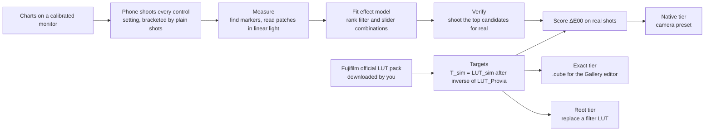

# Architecture

How a Fujifilm look gets onto a stock phone camera, and how every number in this project is measured.
The README gives the idea in a page; this file is the pipeline behind it.

## How to read this file

- **Built** means it exists and has run. **Planned** and **not built** mean exactly that.
- Evidence is `file:line`. Every path starting `pilot/` is in the pilot's working folder,
  `Projects/xiaomi-14t-fuji-filters/` in Ethan's Vault. Line numbers were read on 27 October 2026 and will drift.
  `research/` is `Projects/android-film-simulations/research/`.
- **The scripts are not in this repository yet.** This repository holds the README, the licence, this file and
  `.gitignore`. The code below ran in the pilot on a POCO X6 Pro (Xiaomi HyperOS) and moves here when the pilot is
  tidied for release. Nothing has run on a second phone.

## 1. Three rules

1. **Measure, never eyeball.** A look is scored in CIEDE2000 (ΔE00) against Fujifilm's own data, next to two reference
   numbers: the error of doing nothing and the measuring rig's own noise (section 6).
2. **Real photos are the only result.** The fitted model only ranks candidates; the winners are shot for real and only
   those shots are scored (`pilot/scripts/fit.py:9-11`, `pilot/scripts/fit2.py:16`).
3. **Ship the generator, never Fujifilm's LUTs.** Fujifilm publishes its film-simulation LUTs for free, but its terms do
   not allow redistribution (the terms text itself was not retrievable: `research/competitors-2026-10-19.md:216`, so a
   human read is still owed before any generated LUT is published). This repository carries code only. You download the
   pack yourself and the scripts build the phone LUTs and presets on your machine. In the pilot the pack, the targets
   and the cubes are git-ignored (`pilot/HANDOVER.md:244`; the source path is `pilot/scripts/build_targets.py:39`).
   Other projects redistribute derived Fuji LUTs with no licence, which is the trap this avoids
   (`research/competitors-2026-10-19.md:134`).

## 2. The pipeline

Built end to end on the pilot phone. The order the pilot ran is `pilot/scripts/run_pilot_chain.sh`, resumable from each
sweep's `log.jsonl` (`pilot/HANDOVER.md:48-58`).

### 2.1 Capture

- **Charts.** `pilot/scripts/charts.py:1-13` draws a 60-patch chart (24 ColorChecker colours, a 12-step neutral ramp, a
  24-colour hue ring) with four ArUco markers. `charts.py:102-110` makes three 135-colour pages: two to learn from, one
  held out to test on.
- **Greys.** The monitor's white plus the phone's fixed white balance gave a magenta cast, so the chart is scaled in
  linear light until the greys read grey (`charts.py:163-175`; gains `0.752 0.899 1.0`, `pilot/HANDOVER.md:44`).
- **Rig.** The phone sits on a stand facing the monitor in a dark room, Pro mode locked to ISO 50, 1/50 s, 6500 K,
  manual focus (`pilot/HANDOVER.md:44-45`; the driver refuses to shoot if those are not showing,
  `pilot/scripts/poco_sweep.py:279`). Absolute monitor accuracy does not matter, because every target is computed from
  the phone's own shot of the chart (`charts.py:8-9`).
- **Bracketing.** The monitor drifts about 0.07 ΔE per minute (`pilot/HANDOVER.md:46`). So every setting is shot between
  two plain shots (`poco_sweep.py:172-181`), and `fit2.brackets` (`pilot/scripts/fit2.py:72-91`) reads the setting
  against the mean of the two neighbours, ignoring a neighbour more than six minutes away.
- **Scale.** About 490 photos in the pilot (`pilot/PILOT-REPORT.md:9-23`).
- **Phone driving.** Over adb; the heat and battery guards are `poco_sweep.py:241-310`. The shared guard module
  `claude-phone\phone-guard\` that the rulings name (`pilot/HANDOVER.md:15`) is not wired into the pilot code: the
  pilot still has its own thresholds (44 °C pause, 39 °C resume, `poco_sweep.py:241`).

### 2.2 Measure

`pilot/scripts/measure.py` reads a chart from a phone photo:

1. Finds the four ArUco markers at several scales and fits a homography (`measure.py:41-75`). The chart is shot
   slightly out of focus on purpose, to remove moire from the screen's pixel grid (`measure.py:44-46`).
2. Samples the middle 50% by 50% of every patch (`measure.py:30`, `88-91`).
3. **ROI method.** Only each patch's own bounding box is converted to linear light and masked, not the whole 12 MP frame
   for every patch (`measure.py:92-100`). Averaging is in linear light, so leftover screen texture cancels
   (`measure.py:3-5`). Checked on 316 shots: XYZ bit-identical to the whole-frame version, CPU per shot 6.99 s to 0.72 s,
   down 89.6% (`pilot/HANDOVER.md:121`; the regression check is `pilot/scripts/check_roi.py:1-15`).
4. Chooses the gamut from the file's ICC profile (`measure.py:33-38`), since the POCO saves Display P3. Output is sRGB
   and CIELAB under D65 (`measure.py:105-117`).

A re-measure of 36 stored per-shot files moved no published number (`pilot/HANDOVER.md:122`).

### 2.3 Targets

`pilot/scripts/build_targets.py:1-10` builds `T_sim = LUT_sim ∘ inverse(LUT_Provia)` from Fujifilm's official F-Log2 LUTs
(65 grid, sRGB in and out). The inverse is scattered-data interpolation refined by Gauss-Newton
(`build_targets.py:179`). The LUT output is read with the sRGB curve because that beat the BT.709 curve against genuine
frames (`build_targets.py:8-12`, re-tested at `pilot/HANDOVER.md:211-221`).

The phone is judged against its own plain photo, so `fit.fuji_target` (`pilot/scripts/fit.py:50-92`) returns the plain
colour plus the change the look makes relative to Provia. Provia is then exactly "do nothing" and scores 0 by
construction. Two repairs for colours the sRGB-defined LUTs cannot express: chroma beyond sRGB is scaled by the look's
own chroma change (`fit.py:56-60`), and colours Provia never produces are pulled in first (`fit.into_provia_gamut`,
`fit.py:95-112`).

Checks:
- **Against genuine Fujifilm JPEGs** of a colour-chart scene: Astia 1.13, Classic Chrome 1.30, Eterna 1.30, Pro Neg Std
  1.17, Velvia 1.11 ΔE00 (`pilot/HANDOVER.md:40`; full table in `pilot/report/reference-validation.md`). Those JPEGs
  were exported through Capture One, so part of the gap is Capture One's (`pilot/PILOT-REPORT.md:50`).
- **Unchecked:** Acros, Classic Neg, Eterna Bleach Bypass and Reala Ace have no genuine reference (`HANDOVER.md:42`).
- **Pro Neg Hi has no official LUT.** It is fitted (RBF, from one real Provia and Pro Neg Hi pair,
  `build_targets.py:310`) and carries a low-confidence label (`HANDOVER.md:41`). It is the one place the pilot fits a
  colour transform from paired images.

### 2.4 Fit and verify (the Native tier)

- **Effect model.** Each control's effect is a smooth map in CIELAB: thin-plate radial basis functions with a linear part
  (`fit2.py:94-102`), trained on two chart pages and tested on the held-out third (`fit2.py:7-9`, `33-34`, `125-128`).
  The first version used a second-order polynomial in sRGB (`pilot/scripts/fit.py:123-133`).
- **Rank.** The model ranks every filter by saturation by contrast combination the phone offers (`fit.py:183`).
- **Verify.** The top candidates per look are shot for real, bracketed (`poco_sweep.py:201`), and scored
  (`pilot/scripts/score_verify.py:1-11`).
- **Photos, not only charts.** `scene_fit.py` and `score_scenes.py` add six natural scenes scored per pixel, because for
  Reala Ace the chart's pick lost to doing nothing on 5 of 6 photos (`pilot/scripts/scene_fit.py:1-15`,
  `pilot/HANDOVER.md:174`). `choose_final.py:1-20` picks each look's final advice from real shots only, weighing chart
  and photos equally.
- **Robustness.** Surround and exposure checks are `pilot/scripts/robustness.py:1-12`. White balance and EV levers were
  tried offline and dropped (`pilot/HANDOVER.md:140-156`).
- **Preset file.** `pilot/scripts/make_preset.py:1-10` writes a Xiaomi Pro-mode preset zip. The POCO's presets carry
  exposure only, so on the POCO the user dials the filter and sliders by hand (`pilot/HANDOVER.md:61`). The Xiaomi 14T's
  presets carry the style and five sliders, but the Pro filter is stored only from camera 6.4 (`HANDOVER.md:60`); not
  yet tested on a 14T.

### 2.5 The `.cube` and PNG LUT export (the Exact tier)

- **How the cube is made.** It is not fitted from phone photos. It is the target above, sampled on a 64-point grid:
  `pilot/scripts/make_editor_cubes.py:91-110` (grid from `build_targets.cube_points`, line 140; written by `write_cube`, line 127). Two variants per look because the editor's colour handling is unknown:
  `_P3` (Display P3 code values in and out, aimed at the scoring target) and `_sRGB` (the plain `T_sim`)
  (`make_editor_cubes.py:15-22`). Provia is written as a control.
- **Targets a P3 JPEG cannot hold.** The chroma is lowered in Oklab at constant lightness, and each out-of-gamut node
  takes whichever of clipping, the chroma map or a blend is nearest in ΔE00 (`make_editor_cubes.py:51-83`).
- **Editor constraints, read from the decompiled Gallery editor** (Media Editor 1.10.0.8.1): the photo editor takes
  `LUT_3D_SIZE` 16 or 64 only, truncates entries to 8 bits, stores a 512 by 512 PNG (8 by 8 tiles of 64 cubed), and
  keeps at most 6 custom LUTs (`make_editor_cubes.py:3-8`; `pilot/HANDOVER.md:88`). Photo-folder entries are
  pre-compensated for the truncation (`make_editor_cubes.py:86-88`).
- **Scoring the edit.** `pilot/scripts/score_edit.py:1-9` scores an edited copy of the same photo, so there is no drift or
  shot noise. `--simulate` applies the cube on the laptop as an ideal editor would.
- **Result (laptop simulation only):** 0.18 to 0.39 ΔE00 mean across the looks, worst colour at most 2.7
  (`pilot/HANDOVER.md:104`); the pilot report quotes 0.2 to 0.4 (`pilot/PILOT-REPORT.md:31-43`).

### 2.6 The on-phone route

| Tier | Mechanism | State |
| --- | --- | --- |
| Native | A camera preset: built-in filter plus sliders chosen by the fit | **Built and measured** on the POCO: Velvia, Classic Chrome, Pro Neg Std and Acros land at about 2 to 3 ΔE00; Classic Neg and Bleach Bypass only lean the right way (`pilot/PILOT-REPORT.md:45-47`). Four looks are best left alone (`PILOT-REPORT.md:33-38`) |
| Exact | The stock Gallery editor's `.cube` import, one tap after the shot | **Cubes built; the phone test has not run.** Blocked at the editor's user agreement, since approved (`pilot/HANDOVER.md:9,98`, queue item `HANDOVER.md:128`). The code read says Display P3 stays P3 in the editor, so the `_P3` set should be right (`HANDOVER.md:94-97`); that is a reading, not a measurement. An editor probe is built to settle texel addressing and save-time conversion (`pilot/scripts/make_editor_probe.py`, `HANDOVER.md:210`) |
| Root | Replace a built-in camera filter's lookup table | **Research only.** The Pro filters are LUT PNGs in the camera APK; four swap routes are ranked (`pilot/HANDOVER.md:108-117`). The POCO is not rooted (`HANDOVER.md:117`) |

Not built: the Phantom-style route (watch the Gallery for new stock-camera photos and grade them automatically), which
is the idea ranked first in `research/competitors-2026-10-19.md:178`. Also not built: any Android app, installer or
one-tap install. The README's "quick install" is the goal, not a state.

## 3. Ideas borrowed, and what is deliberately not

| Idea | Source and licence | What this project does with it | Built? |
| --- | --- | --- | --- |
| **Fit a LUT from paired RAW and JPEG shots** | `darktable_lut_generator` (wilecoyote2015): PyPI, licence field empty (`research/competitors-2026-10-19.md:169`). Related: bastibe's Darktable film-simulation panel, public domain, fits a colour-chart shot under each in-camera look (`:122`). sLUTy, no licence, publishes held-out validation (`:128`) | The method is re-implemented, never copied. The **differentiator** is a per-patch CIEDE2000 report on held-out colours, scored on real shots, so a look's error is stated rather than judged by eye (`pilot/scripts/score_verify.py:96-135`) | **Partly.** The pair-fit exists only for Pro Neg Hi (`build_targets.py:310`). The Exact-tier cubes come from Fujifilm's LUT, not from fitting phone photos. A general RAW/JPEG pair LUT fitter is **not built** |
| **Grain and halation as a separate pass** | spektrafilm, GPL-3.0 (`:149`); FilmCamera-Android, MIT (`:106`) | Idea only; no GPL code enters this MIT repository. The colour fit is scored with spatial effects off, and any grain stage would be optional and never move the colour numbers. sLUTy states the same requirement (`:128`) | **Not built** |
| **A GLSL live preview** | PhotonCamera, Apache-2.0: `.cube` import with a real-time GPU preview (`:99-100`). FilmCamera-Android, MIT: a clean `.cube` parser and GLES3 renderer (`:109`) | Planned: preview the same `.cube` the Exact tier uses, so what you see is what the editor applies. Small pieces may be reused with attribution; becoming a camera-replacement app is not the goal | **Not built** |
| **Validation design** | sLUTy (idea only); Spektrafilm-android's tolerance-gated reference cases, GPL-3.0 (idea only, `:30`) | Held-out colours and a reported error floor are built (`fit2.py:33-34`, `119`). A pinned-reference regression suite for every LUT build is **not built** (`check_roi.py` covers `measure.py` only) | Partly |

Rejected: bundled LUTs of unclear provenance, extracted vendor LUTs, and any code with no licence
(`research/competitors-2026-10-19.md:80,109,113`).

## 4. Rule: the generator ships, Fujifilm's LUTs do not

- No file derived from Fujifilm's LUTs is committed here: not the targets, not the `.cube` or PNG outputs, not the
  validation tables derived from them.
- Genuine Fujifilm JPEGs used as references (bastibe's, via Capture One) stay local too.
- This repository's `.gitignore` (lines 2-12) already excludes `sources/`, `targets/`, `*.cube`, `*.npy`, `captures/`,
  `reference/`, `diagnostics/` and `backups/`. It does **not** yet cover PNG LUT exports (the 512 by 512 tile PNGs) or
  `report/` tables derived from Fujifilm's data; add those before the scripts are moved in. The PNG export itself is
  not built: the editor converts the `.cube` to PNG on the phone (`make_editor_cubes.py:3-8`).
- Downloads the pipeline needs are the user's: Fujifilm's LUT pack, plus the reference JPEGs for validation.

## 5. Where the gaps are

- **Absolute accuracy.** Targets are relative to the phone's own Provia. The gap between a phone's Provia and a real
  Fujifilm camera's is not measured. A first attempt found about 13 ΔE00 but dominated by what the monitor really emits,
  which only a colorimeter or a physical ColorChecker shot in daylight can settle (`pilot/HANDOVER.md:158-172`).
- **Target truth is now the limit.** The target sits 1.1 to 1.3 ΔE00 from genuine files, more than the Exact tier's own
  0.2 to 0.4. In-camera sources that could settle it are identified but not downloaded (`pilot/HANDOVER.md:184-195`).
- **Out-of-sRGB colours.** 68 of the 135 held-out colours lie outside sRGB, where no genuine file checks the target, and
  preset scores are worse there (`pilot/HANDOVER.md:196-209`).
- **Some pilot outputs do not reproduce.** `poco-fit2.json`, `poco-fit.json`, `poco-residuals.json` and
  `ev-estimate.json` do not regenerate from the current code (`pilot/HANDOVER.md:122`). The published verify and scene
  numbers do not read them.
- **One phone.** Only the POCO X6 Pro has run. The Xiaomi 14T, Galaxy S24 Ultra and Huawei P30 Pro have research notes
  only (`pilot/HANDOVER.md:243`).

## 6. The accuracy bar

A look is reported as three numbers, all ΔE00 on the same colours:

1. **The look**: the phone's real shot with the setting, against the target.
2. **Doing nothing**: the plain photo against the same target (`pilot/scripts/score_verify.py:109`). A preset that does
   not beat this has not earned a place, and the advice for that look is to leave the camera alone
   (`pilot/PILOT-REPORT.md:25`).
3. **The rig's noise floor**: the two bracketing plain shots against each other (`score_verify.py:96`). It is 0.18 in
   the pilot (`PILOT-REPORT.md:29`; shot-to-shot noise about 0.2, `pilot/HANDOVER.md:47`).

Reading rules:
- Under 1 is invisible, 2 to 3.5 is visible only side by side, over 5 is a different colour
  (`pilot/PILOT-REPORT.md:29`).
- The 0.18 figure is for one colour. The noise of a 405-colour mean is smaller, about 0.01 plus drift
  (`pilot/HANDOVER.md:153`). Differences of a few hundredths are still not claimed.
- A score is not read as better than the target's own truth (section 5).
- The Exact tier's 0.2 to 0.4 is a laptop simulation of an ideal editor, so it is quoted as such until the phone test runs
  (`README.md:19`).
- Held-out numbers are reported next to all-patch numbers (`score_verify.py:7`), and natural-photo scores next to chart
  scores (section 2.4).

Pilot results, POCO X6 Pro, real shots (`pilot/PILOT-REPORT.md:31-43`):

| Look | Setting | Look | Doing nothing | Exact `.cube` (simulated) |
| --- | --- | --- | --- | --- |
| Velvia | Original, Sat +2, Con +1 | 2.51 | 3.28 | 0.29 |
| Classic Chrome | Original, Sat -1, Con +1 | 3.07 | 4.78 | 0.24 |
| Acros | Original, Sat -3, Con +1 | 2.07 | 25.63 | 0.24 |
| Classic Neg | Vivid, Sat -2, Con 0 | 6.82 | 8.45 | 0.34 |

The full eleven-look table is in the pilot report.
