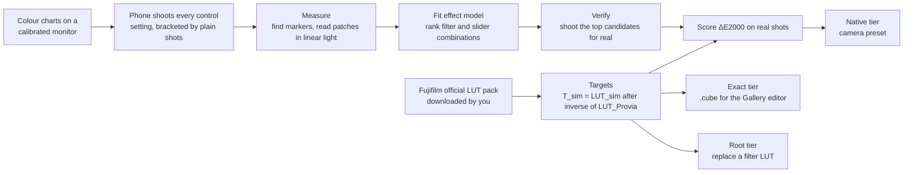

# Architecture

How a Fujifilm look gets onto a stock phone camera, and how every number in this project is measured.
The README gives the idea in a page; this file is the pipeline behind it.

> **Status (October 2026):** private and early. The pipeline below ran end to end on a POCO X6 Pro. The
> scripts still sit in the pilot's working folder and move into this repository when the pilot is tidied for
> release; nothing here has run on a second phone yet. Where a step is designed but not yet proven, it says so.

## 1. The principle

Three rules decide every design choice:

1. **Measure, never eyeball.** A look is scored in CIEDE2000 (ΔE2000) against Fujifilm's own data, and the score
   always sits next to two reference numbers: the error of doing nothing, and the measuring rig's own noise.
2. **Real photos are the only result.** The fitted model ranks candidates; it is never quoted as an outcome.
   Every published number comes from a real shot of the phone.
3. **Ship the generator, never Fujifilm's tables.** Fujifilm publishes its film-simulation LUTs for free but does not
   allow redistribution. This repository carries code only. You download Fujifilm's pack yourself and the scripts
   build the phone LUTs and presets on your machine. No Fujifilm-derived data is ever committed.

## 2. The pipeline

### 2.1 Targets
The target for a look is Fujifilm's own transform, built from its official F-Log2 LUTs:
`T_sim = LUT_sim ∘ inverse(LUT_Provia)`, with sRGB in and out. The phone is judged against its own plain photo, so for
any neutral shot the target is `plain + (T_sim(plain) − T_Provia(plain))` in CIELAB. Provia is therefore exactly
"do nothing" and scores 0 by construction. Targets are checked against genuine Fujifilm JPEGs of a colour-chart
scene (mean ΔE2000 about 1.1–1.3 for the five looks that have one); looks with no genuine reference are labelled
unchecked, and Pro Neg Hi, which has no official LUT, is fitted separately and carries a low-confidence label.

### 2.2 The rig and the measurement
A phone on a stand shoots charts on a monitor in a dark room, with exposure, ISO, white balance and focus locked.
Each chart carries four ArUco markers: the measurement step finds them, un-warps the photo and averages the middle
half of every patch in linear light, so leftover screen texture cancels rather than biasing the mean. Only each
patch's own bounding box is converted to linear light, which keeps a 12 MP shot to under a second of CPU.

The monitor drifts slowly, so every setting is **bracketed** by plain shots (plain, setting, plain, ...) and its effect
is read against the mean of its two neighbours. Drift moves both sides of the comparison together and cancels.

### 2.3 Fit, verify, score
- **Fit.** Each control's effect is a smooth map in CIELAB (radial basis functions plus a linear part), learnt on two
  chart pages and tested on a third page of colours the fit never saw.
- **Rank.** The model ranks every combination of filter and sliders the phone offers.
- **Verify.** The best candidates per look are shot for real, bracketed. Only these shots are scored.
- **Natural photos.** Each look's winner is also shot on natural scenes and scored per pixel, because a setting that
  wins on a chart can lose on photographs.

### 2.4 The three tiers

| Tier | Mechanism | Status |
| --- | --- | --- |
| Native | A camera preset: the phone's built-in filter plus sliders, chosen by the fit | Proven on the POCO pilot, about 2–3 ΔE for most looks |
| Exact | The stock Gallery editor's `.cube` import, one tap after the shot | Laptop simulation about 0.35 ΔE; the phone test is pending |
| Root | Replace a built-in filter's lookup table with a Fuji one | Researched only; needs a rooted phone |

## 3. Ideas borrowed, and what is deliberately not

Each idea below came from public work found in a survey of open projects (October 2026). Ideas are taken freely; code
is taken only where the licence allows it, and always with attribution.

| Idea | Where it comes from | How it is used here | Licence position |
| --- | --- | --- | --- |
| **Fit a LUT from paired RAW and JPEG shots** | The `darktable_lut_generator` method, and bastibe's Darktable film-simulation panel, which fits a colour-chart shot under each in-camera look | The same idea of fitting from known pairs. What this project adds, and where it differs, is a CIEDE2000 report for **every patch**, measured on held-out colours, so a look's error is stated rather than judged by eye | The generator's licence field is empty, so the method is re-implemented, not copied |
| **Grain and halation as a separate pass** | spektrafilm and other film-emulation projects | Kept out of the colour LUT on purpose. The colour fit is scored with spatial effects off; grain and halation, if added, are a later optional stage that can be switched off and never move the colour numbers | spektrafilm is GPL-3.0: idea only, no code in this MIT repository |
| **A GLSL live preview** | PhotonCamera's real-time LUT preview, which runs on the GPU | Planned: the same `.cube` the exact tier uses, previewed on the GPU, so what you see is what the editor will apply | PhotonCamera is Apache-2.0: small pieces may be reused with attribution; a camera-replacement app is not the goal |
| **Ship the generator, never the LUTs** | The precedent set by projects that keep imported tables on the user's machine | Section 1, rule 3 | n/a |

## 4. What this design does not claim
- The exact tier's 0.35 ΔE is a laptop simulation of an ideal editor. Whether the real editor applies a `.cube` to P3
  code values (the P3 set wins) or converts to sRGB first (the sRGB set wins) is the pending phone test.
- Targets are relative to the phone's own Provia. The gap between a phone's Provia and a real Fujifilm camera's is not
  measured; closing it needs a physical colour chart shot in daylight.
- A score is never read as more precise than the rig's shot-to-shot noise (about 0.2 ΔE for one colour).
